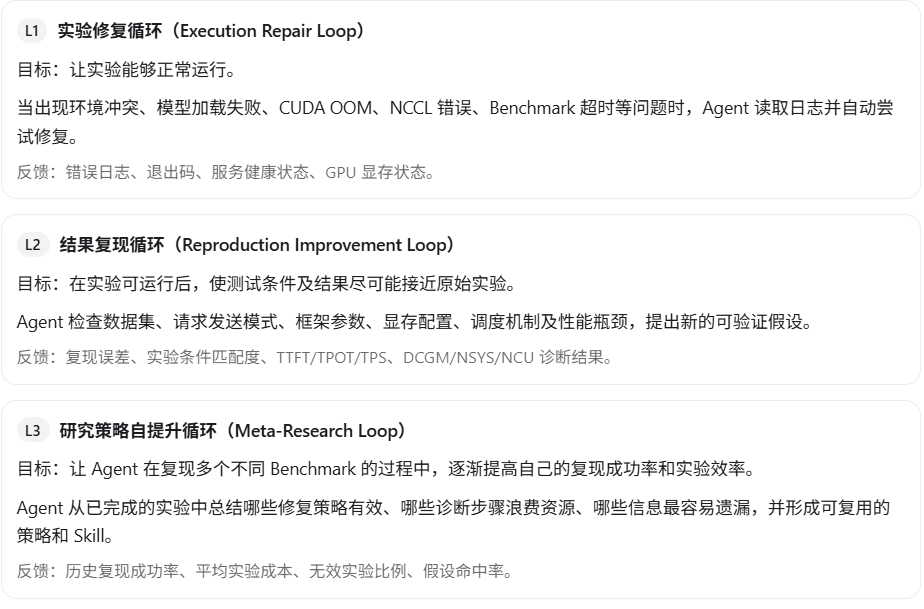
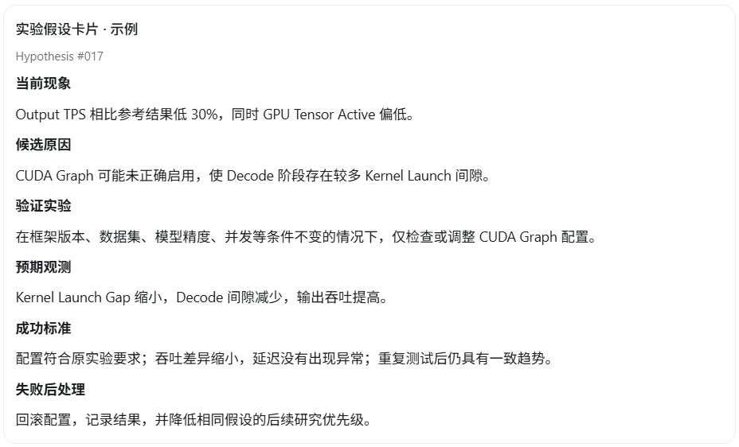
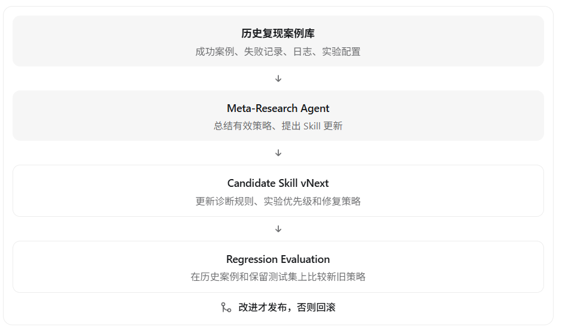
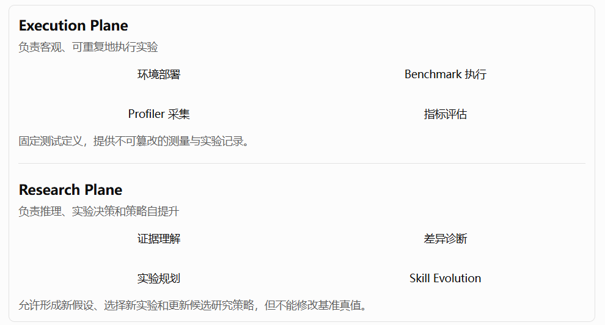

# 基于 RSI 的 LLM Benchmark 自动复现 Agent 架构设计


理解别人的实验 → 重建实验环境 → 自动执行 → 比较结果 → 分析差异 → 修正实验方案 → 再次验证。

## 一、核心架构思路

先明确一个非常重要的原则：

自动复现 ≠ 自动性能优化。

二者虽然都可以使用 RSI 循环，但优化目标完全不同。

| 维度     | 自动复现 AutoReproduce             | 自动优化 AutoResearch    |
| -------- | ---------------------------------- | ------------------------ |
| 目标     | 尽可能复现已有实验结果             | 寻找更好的实验结果       |
| 输入     | 论文、博客、GitHub、Benchmark 表格 | 当前代码、配置和优化目标 |
| 评价标准 | 与原始结果的一致性                 | 是否优于历史最优         |
| 修改内容 | 环境、依赖、部署参数、测试流程     | 算法、Kernel、框架配置   |
| 成功标准 | 条件一致且指标误差可接受           | 性能改善且满足约束       |
| 典型风险 | 改变测试条件后伪造出相近性能       | 为提高分数而改变评价标准 |

例如，别人使用 8×H20、GLM、TP8 得到 900 output tok/s。

你复现出了 600 tok/s。

Agent 不能简单通过修改输入长度、减少输出长度或打开原实验没有使用的推测解码来让结果达到 900 tok/s，然后宣布复现成功。

它需要先判断：究竟是测试条件不同，还是相同测试条件下存在部署或执行效率差异。

# 二、推荐的系统整体架构


底层需要三个共享基础设施：

- Experiment Store：保存配置、环境、日志、指标、Profiler 结果和实验血缘。
- GPU Resource Manager：GPU 拓扑检查、资源独占、实验调度、环境清理。
- Policy & Safety Guard：保护原始基准条件、限制可修改范围、控制实验成本、审批高风险变更。

建议第一版采用一个主控 Agent + 多个确定性工具，不必一开始就实现多个自治 Agent。这样实验行为更可控、容易复现和调试。

# 三、第一核心模块：自动理解别人的 Benchmark

这是整个系统最难、也最影响复现成功率的模块之一。

你的 Agent 必须把自然语言资料转换成机器可执行的实验规范。

例如用户提供：

> 8×H20，GLM-5.2-FP8，vLLM，TP8，ISL=8192，OSL=1024，并发 64，输出吞吐为 800 tok/s。

Agent 应提取为结构化配置。

```
experiment:
  id: glm-h20-reproduction-001
  goal: reproduce

source:
  type: github
  url: "https://example.com/benchmark"
  reference_result:
    output_tps: 800

hardware:
  gpu_model: H20
  gpu_count: 8
  topology: null

model:
  name: GLM-5.2-FP8
  revision: null
  quantization: fp8

deployment:
  framework: vllm
  framework_version: null
  tensor_parallel: 8
  pipeline_parallel: 1
  kv_cache_dtype: null

workload:
  input_tokens: 8192
  output_tokens: 1024
  concurrency: 64
  num_prompts: null
  dataset: null
  arrival_pattern: null
  prefix_caching: null

metrics:
  - output_tps
  - mean_ttft
  - mean_tpot
  - p95_ttft
  - p95_itl

reproduction:
  tolerance: 0.10
  repeats: 3
  baseline_locked: true
```

这里的模型和吞吐数字只是架构示例，不代表真实实测；10% 容差也是演示值。

这里我建议采用一个很重要的设计：

## 每个提取出的条件，都必须包含证据状态

| 状态        | 含义                   | 处理方式                     |
| ----------- | ---------------------- | ---------------------------- |
| Explicit    | 原文明确给出           | 锁定，不允许 Agent 擅自修改  |
| Derived     | 从其他信息推导得到     | 记录推导规则，允许审查       |
| Assumed     | Agent 推测或使用默认值 | 必须标注，优先验证           |
| Unknown     | 无法从原文确定         | 保留未知，不得伪装成原始条件 |
| Conflicting | 多份资料相互矛盾       | 触发证据核查或人工确认       |

例如，原文没有写 `enable_prefix_caching`，Agent 就不能直接假设它是关闭的。

它可以通过框架版本确认默认行为，或者使用明确标注的候选设置做对照实验。

这一点决定了整个自动复现系统是否值得信任。

# 四、第二核心模块：RSI 自提升循环应该怎么设计？

我建议你的 RSI 不仅包含一个循环，而是设计成三个不同层级的反馈循环。



三个循环的作用不同：

L1 解决“能不能运行”，L2 解决“能不能复现”，L3 解决“下一次能否更快、更可靠地复现”。

其中 L3 才是你要重点体现的递归自我改进能力。仅仅不断调整部署参数，并不等于系统的研究方法在自我提升。

## RSI 控制器的核心伪代码

```python

def autoreproduce(source, gpu_cluster):
    spec = extract_and_verify_spec(source)
    lock_reference_conditions(spec)

    history = []
    best_valid = None

    for iteration in range(MAX_ITERATIONS):
        hypothesis = researcher.propose(
            spec=spec,
            history=history,
            knowledge=knowledge_base,
        )

        # 只允许修改经过授权的变量
        candidate = policy.validate_and_apply(
            hypothesis, spec
        )

        # 每次实验创建隔离环境
        result = executor.run(
            candidate,
            gpu_cluster=gpu_cluster,
        )

        if result.failed:
            diagnosis = diagnose_execution_failure(result)
            history.append((candidate, result, diagnosis))
            continue

        evaluation = evaluator.compare(
            reference=spec.reference,
            actual=result,
            check_conditions=True,
            check_statistics=True,
        )

        history.append((candidate, result, evaluation))

        if evaluation.valid:
            if is_better_reproduction(evaluation, best_valid):
                best_valid = evaluation

        if evaluation.passed:
            break

    # 将成功/失败经验生成候选 Skill
    candidate_skill = meta_researcher.learn(history)

    # 必须通过回归验证，才能提升为正式规则
    knowledge_base.propose(candidate_skill)

    return generate_reproduction_report(
        spec, history, best_valid
    )

```

这里的“更好”必须表示复现可信度提高、条件差异减少、统计偏差减少，而不是单纯吞吐越来越高。

# 五、RSI 的实验决策机制：如何让 Agent 自动决定下一步？

这是我认为最需要你精心设计的部分。

建议 Agent 每一轮只改变一个主要因素，形成明确的因果假设。

例如原始结果为 1000 tok/s，而当前只有 700 tok/s。

Agent 不应该同时修改 TP、KV Cache dtype、CUDA Graph、Batch Size 和量化方式，因为最终无法知道是哪一个改变产生作用。

推荐采用以下机制：



## 实验优先级如何计算？

可以为每个候选实验估算一个优先级，这里不是要求 LLM 准确预测每个概率，而是通过规则、历史经验和实验统计给出可解释的排序。

例如：

| 候选实验                        | 预期价值         | 实验成本 | 优先级           |
| ------------------------------- | ---------------- | -------- | ---------------- |
| 检查数据集和真实 Token 长度     | 高               | 低       | 很高             |
| 核对 vLLM/SGLang 版本与默认参数 | 高               | 低       | 很高             |
| 重新执行一次 Benchmark          | 中               | 中       | 高               |
| 开启短时 DCGM 采样              | 中               | 低       | 高               |
| 执行 NSYS Profiling             | 高               | 中       | 中               |
| 对多个 Kernel 全量执行 NCU      | 高               | 高       | 较低             |
| 修改模型精度以追赶吞吐          | 会破坏条件一致性 | —        | 禁止计入严格复现 |

因此，Agent 应该遵循：

先检查配置和测试口径 → 再做低成本验证 → 最后执行高成本 Profiling。

而不是每次性能不一致，就自动启动一次完整的 NCU。

# 六、让你现有的性能分析 Skill 成为 RSI 的诊断引擎

你已经整理了传统测试、DCGM、算子分类、NCU、CUPTI 的分析规则。

这些可以直接转成 Agent 的诊断决策表。

| 复现过程中观察到的现象 | Agent 调用的工具              | 下一步研究                             |
| ---------------------- | ----------------------------- | -------------------------------------- |
| 吞吐明显低于原结果     | Benchmark + DCGM              | 判断工作负载口径、GPU 活跃程度         |
| TTFT 差异较大          | Benchmark + 队列/Prefill 指标 | 检查请求到达方式、排队及 Prefill 配置  |
| TPOT 较高              | DCGM + NSYS                   | 检查 Decode Kernel 与调度间隙          |
| Tensor Active 较低     | NSYS + NCU                    | 分析 GEMM Shape、Tensor Core 吞吐      |
| DRAM 压力较高          | NCU                           | 分析 L2 Hit、DRAM Throughput、Roofline |
| TP 扩展效果较差        | NSYS + NCCL + NVLink          | 分析通信耗时、拓扑及同步               |
| HtoD/DtoH 频繁         | CUPTI + CUDA API Trace        | 分析小数据拷贝和同步                   |
| OOM 或 KV Cache 不足   | 显存监控 + 服务日志           | 检查模型精度、缓存配置及请求驻留数量   |

要注意这里的工具输出是证据，不是自动成立的结论。

例如 DRAM Active 高，只能触发进一步的带宽验证，不能直接让 Agent 认定 HBM 带宽不足。

这能有效减少 RSI 中的一个常见问题：Agent 因错误假设连续开展大量无效实验。

# 七、复现评分体系：不能仅依赖吞吐误差

我建议设计一个多维度 Reproduction Score，但先进行有效性门控，再计算分数。

| 维度         | 评价内容                             | 是否必须通过      |
| ------------ | ------------------------------------ | ----------------- |
| 实验环境匹配 | GPU、模型版本、量化方式、框架版本    | 严格复现必须      |
| 工作负载匹配 | ISL/OSL 分布、请求模式、并发、数据集 | 严格复现必须      |
| 测试口径一致 | TPS、TTFT、TPOT 的计算定义           | 必须              |
| 结果有效性   | 无异常失败、测量完整、正确性满足要求 | 必须              |
| 性能一致性   | TPS、TTFT、TPOT 与目标差异           | 核心评分          |
| 统计稳定性   | 多轮测试方差、置信区间               | 核心评分          |
| 研究成本     | GPU 小时数、迭代次数、工具开销       | 用于 RSI 策略优化 |

若参考资料只给了 TPS，就只比较 TPS；不能为了填满公式而编造 TTFT、TPOT 的参考值。

复现结果建议划分为：

- Strict Reproduced：关键条件完全匹配，误差及统计检验通过。
- Approximate Reproduced：条件存在明确、可解释的差异，结果接近。
- Not Reproduced：有效实验完成，但结果不一致。
- Blocked：缺少关键环境、模型或数据，无法开展有效比较。
- Invalid：执行过程存在错误或测试口径不一致。

还要防止一个陷阱：不能以某次测量“碰巧更接近原值”作为成功标准。应采用固定次数的独立重复试验，汇总均值、波动范围与置信区间。

# 八、RSI 真正的自提升：如何让 Agent 越做越好？

这一层我推荐借鉴 [Karpathy AutoResearch](https://github.com/karpathy/autoresearch?utm_source=chatgpt.com) 的实验历史与保留/回滚机制。其原始实现将评价方式固定，并对每个候选改动记录结果，只有有效改进才保留。

但你的系统不能直接照搬“分数更好就保留代码”的策略，因为复现不同模型、不同硬件时没有统一的单一分数。



### 可以自我提升的内容

| 可进化组件                  | 自提升方式                                     |
| --------------------------- | ---------------------------------------------- |
| 文献解析 Skill              | 提高实验条件提取准确率，减少遗漏               |
| Deployment Skill            | 积累模型、框架与 GPU 的兼容性经验              |
| Failure Diagnosis Skill     | 建立 CUDA OOM、NCCL、CUDA Graph 等故障处理策略 |
| Benchmark Skill             | 提高测试口径核查和异常识别能力                 |
| Performance Diagnosis Skill | 改进 DCGM/NCU/CUPTI 证据到验证实验的映射       |
| Experiment Planner          | 减少无效测试和 GPU 消耗                        |
| Research Policy             | 提高正确假设的优先级与复现成功率               |

### 不允许自主修改的部分

原始参考结果、源证据、严格复现所锁定的条件、测量公式、正确性门槛、安全策略和 GPU 资源上限。

另外，Agent 从网上读取的 README、论文和脚本都属于外部输入。不能将其中的文字直接当成系统执行指令。安装依赖、运行第三方脚本和修改环境需要在隔离环境及授权范围内完成。

# 九、工程实现建议

我建议的技术栈如下。

| 层级           | 推荐实现                                           |
| -------------- | -------------------------------------------------- |
| Agent 推理     | GPT 系列等支持工具调用的模型                       |
| 流程编排       | LangGraph 或自建状态机                             |
| 长时实验调度   | Temporal / Kubernetes Jobs                         |
| GPU 资源管理   | Kubernetes + NVIDIA GPU Operator，或现有集群调度器 |
| 实验元数据     | PostgreSQL                                         |
| 结果和日志存储 | S3 / MinIO                                         |
| 实验追踪       | MLflow 或自建 Experiment Registry                  |
| 知识检索       | PostgreSQL + pgvector                              |
| 版本控制       | Git + 固定 Commit / 镜像 Digest                    |
| 性能采集       | Benchmark、DCGM、NSYS、NCU、CUPTI                  |

Bench 执行层建议直接复用现有工具。比如 SGLang `bench_serving` 已提供可控并发、请求速率、TTFT、TPOT、吞吐等数据及 JSONL 输出，无需重新开发整个压力发生器。

## 项目目录结构建议

```
autoreproduce/
├── agents/
│   ├── evidence_agent.py
│   ├── planner_agent.py
│   ├── diagnosis_agent.py
│   └── meta_research_agent.py
│
├── core/
│   ├── state_machine.py
│   ├── experiment_spec.py
│   ├── policy_guard.py
│   ├── evaluator.py
│   └── rsi_controller.py
│
├── executors/
│   ├── deploy_executor.py
│   ├── benchmark_executor.py
│   └── profiler_executor.py
│
├── collectors/
│   ├── dcgm.py
│   ├── nsys.py
│   ├── ncu.py
│   └── cupti.py
│
├── skills/
│   ├── literature_extraction/
│   ├── environment_repair/
│   ├── llm_performance_diagnosis/
│   └── experiment_planning/
│
├── evaluations/
│   ├── reproduction_metrics.py
│   ├── regression_suite.py
│   └── benchmark_cases/
│
├── storage/
│   ├── experiment_registry.py
│   └── knowledge_base.py
│
└── reports/
    └── reproduction_report.py
```

每次实验至少记录四个标识：

`source_id`（参考文献）、`spec_id`（锁定规范）、`run_id`（实际执行）、`policy_version`（使用的 Agent/Skill 版本）。

这样不仅能追溯一次测试为什么得到这个数值，还能追溯是哪个版本的 Agent 决定运行这个实验。

# 十、建议分三个阶段落地

阶段一：MVP 自动复现

实现 GitHub/论文解析 → 实验配置提取 → 单机 vLLM/SGLang 部署 → Benchmark → 误差报告。

第一阶段只支持一种框架、固定 GPU 资源和少量模型，不必加入复杂的 Profiler。

阶段二：RSI 实验闭环

增加失败自动修复、假设生成、差异分析、实验优先级、受控参数调整和自动回滚。

集成 DCGM、NSYS、NCU、CUPTI，重点验证无法复现时的根因。

阶段三：跨任务策略自提升

建立 Benchmark 案例库，自动形成候选 Skill，在独立历史案例上回归评估，再通过审批或受控发布机制更新 Agent 策略。

这一阶段才开始真正评估 RSI 是否带来持续收益。

## 如何证明 RSI 真的有效？

不要只展示 Agent 成功复现了一份报告。应该建立固定案例集，比较：

| 评价指标                          | 说明                                            |
| --------------------------------- | ----------------------------------------------- |
| Reproduction Success Rate         | 指定实验预算内，成功复现的比例                  |
| Time to Reproduce                 | 从获取资料到有效复现的时间                      |
| GPU Hours per Success             | 每次成功复现消耗的 GPU 资源                     |
| Experiment Efficiency             | 有效实验 / 总实验次数                           |
| Configuration Extraction Accuracy | 原文实验参数提取的准确率                        |
| False Reproduction Rate           | 条件不匹配却被错误判定复现成功的比例            |
| Cross-task Generalization         | 新 Skill 在未见过的模型、硬件和报告上的改进幅度 |

对 RSI 来说，最后两个指标尤其重要。

如果新策略只让系统在已经做过的 GLM/H20 实验上表现更好，却不能提高新的 DeepSeek/B200 实验的复现成功率，那么它更可能是案例记忆，而非可泛化的研究能力提升。

# 十一、我最推荐的最终架构

你的系统可以分成两个核心平面：



这种设计比一个能够任意执行命令、修改代码、判断成功与否的超级 Agent 更可靠，也更适合 GPU 集群和性能测试这样的高成本环境。

最终建议：

你的 AutoReproduce 系统应该具备两条循环：

**内循环（Reproduction Loop）：针对某份 Benchmark，不断减少配置差异、解决部署问题、验证性能差异，直到成功复现或达到实验预算。**

**外循环（RSI Meta Loop）：复盘多个复现任务，改进证据提取、故障诊断与实验规划策略，并通过独立回归测试决定是否发布新版本 Skill。**

这样，Agent 才能从“自动执行测试的工具”，演进为能够积累研究经验、验证自己的假设、持续提高复现能力的自动研究系统。